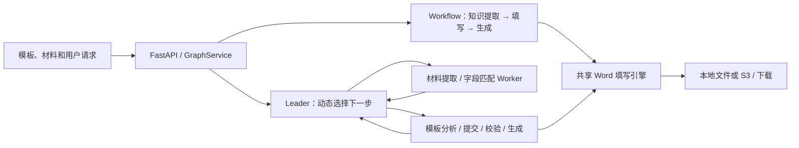

# 格智 FormWise — 智能文档自动填写系统

[](https://github.com/xiaojian-fei/doc-auto-filler/actions/workflows/tests.yml)

上传 Word 模板和参考材料，识别待填字段，通过 AI 预填、对话或人工编辑完成填写，再生成可下载的 `.docx`。

项目已移除 Coze（扣子）的运行时、模型鉴权和存储依赖，可独立部署。默认使用本地文件存储；AI 功能接入自行配置的 OpenAI 兼容模型服务。不配置模型也可上传模板、预览、手工填写和生成 Word。

> **权利声明**：保留所有权利（All Rights Reserved），仅供作品展示与交流。未经授权禁止复制、修改、分发或商用。详见 [LICENSE](LICENSE)。

## 主要功能

- 识别常见的冒号、下划线、标签与空白格、复选框、多列及重复行字段。
- 从 txt、md、csv、docx、xlsx、pdf 材料提取信息，给出预填建议和置信度。
- 在协同审核面板和文档预览中修改字段，按字段 ID 区分同名字段，支持零值与清空。
- 通过 python-docx / OpenXML 填写模板，处理文字样式、表格与合并单元格，并检查生成结果。
- 支持原有 Workflow 和可选的 Leader-worker 两种 Agent 编排方式。
- 默认本地生成与下载，可选 S3 存储、PostgreSQL 图历史；PDF 转换需要另外安装 LibreOffice。

复杂模板仍需核对识别与填写结果。当前不提供图片 OCR，旧二进制 `.doc` / `.xls` 请先转换。

## 快速开始

需要 Python **3.12+** 和可在终端运行的 **uv**。

```powershell
git clone https://github.com/xiaojian-fei/doc-auto-filler.git
cd doc-auto-filler/projects
uv sync --frozen

# 仅首次创建，保留已有配置
if (!(Test-Path .env)) { Copy-Item .env.example .env }
```

在 `projects/.env` 填写模型配置。示例使用已联调的 DeepSeek；其他服务需支持工具调用：

```dotenv
EXTERNAL_LLM_BASE_URL=https://api.deepseek.com
EXTERNAL_LLM_MODEL=deepseek-flash
EXTERNAL_LLM_API_KEY=
AGENT_MODE=workflow
STORAGE_BACKEND=local
```

将密钥填入 `EXTERNAL_LLM_API_KEY` 后保存；密钥只放在本地 `.env` 或进程环境变量中。环境变量优先于 `.env`。

```powershell
# 在 projects 目录执行
uv run --frozen python src/main.py -p 5000
```

打开 **http://localhost:5000/web/**；根地址 `/` 也会跳转到该页面。保持单 worker。

Linux/macOS 使用相同的 uv 命令；首次创建配置可用：

```bash
cd projects
uv sync --frozen
[ -f .env ] || cp .env.example .env
# 编辑 .env 后启动
uv run --frozen python src/main.py -p 5000
```

如果只使用手工填写，模型配置可以暂时留空。更多配置见[独立运行与迁移说明](projects/docs/STANDALONE.md)及[配置示例](projects/.env.example)。

## 两种 Agent 架构

| 模式 | 编排方式 | 当前定位 |
| --- | --- | --- |
| `workflow` | Router 按状态选择知识提取、填写、生成 Agent，跳过已完成阶段 | 默认模式 |
| `leader_worker` | Leader 根据工具结果动态调度提取/匹配 Worker，以及提交、校验和生成工具 | 可选实验模式 |



Leader-worker 的提取 Worker 按文件隔离上下文，最多三路并发；匹配候选携带字段 ID、来源证据和置信度。Worker 提供候选，程序负责提交与生成校验；发现来源冲突时可先追问用户。每轮最多八次 Leader 决策、十二次工具执行；这是调度次数限制，不是 Token 或金额限额。

在 `.env` 中设置 `AGENT_MODE=leader_worker` 后重启，也可临时覆盖：

```powershell
$env:AGENT_MODE = 'leader_worker'
uv run --frozen python src/main.py -p 5000
# 停止服务后，设为 workflow 并重新启动即可切回
```

两种模式的图会话命名空间分开。材料超过首版长度限制、复杂同义冲突和跨表行组定位等场景仍需扩展验证。方案见[迭代设计](projects/docs/LEADER_WORKER_PLAN.md)和[实现与验证记录](projects/docs/LEADER_WORKER_REPORT.md)。

## 验证与真实模型对比

当前回归：**82 项 Python 测试、10 项前端行为检查**，以及前端脚本语法、下载链接和转义检查。CI 覆盖 Windows / Ubuntu、Python 3.12 / 3.13。旧代码整理另对六份模板的两个生成入口做了十二组正文 XML 对比，普通字段样例与修改前一致。

2026-10-23 使用同一 DeepSeek 模型、模板和材料，每场景每架构执行一次，共四次真实任务：

| 场景 | 架构 | 验收结果 | 耗时 | 模型调用 | 输入+输出 Token |
| --- | --- | --- | ---: | ---: | ---: |
| 正常填写 | Workflow | 6/6 关键字段正确，指定留空保留 | 32.681 秒 | 10 | 33,007 |
| 正常填写 | Leader-worker | 6/6 关键字段正确，指定留空保留 | 11.723 秒 | 8 | 25,153 |
| 日期冲突 | Workflow | 追问确认，无交付产物 | 16.518 秒 | 10 | 29,629 |
| 日期冲突 | Leader-worker | 追问确认，无交付产物 | 4.376 秒 | 4 | 5,023 |

这两例中填写结果相同，Leader-worker 调用更少；固定顺序、单次测量不足以证明整体准确率或稳定性能优势，Token 数也不等于实际费用。条件、哈希和产物检查见[真实 A/B 报告](projects/docs/LEADER_WORKER_AB_REPORT.md)。

开发验证（在 `projects` 下）：

```powershell
uv run --frozen pytest -q
uv run --frozen ruff check src tests scripts
node tests/check_frontend.cjs
node tests/check_frontend_behavior.cjs
```

上述回归不调用付费模型。配置好服务后，可显式执行真实对比；该命令会调用模型服务并可能产生费用：

```powershell
uv run --frozen python scripts/compare_agent_modes.py --live --mode both
# 单独验证一个场景：追加 --case single_document 或 --case conflicting_dates
```

原始记录和产物保存在被 Git 忽略的 `projects/data/leader-worker-compare/`。

2026-06-09 的历史 21 用例评测平均准确率为 70.2%，不代表当前版本的全量评测结果；原始数据保留在[历史评测报告](eval_report_20260609_181045.md)。

## 项目结构

```text
projects/
├── src/
│   ├── main.py                  # API 与静态页面入口
│   ├── service.py               # 图执行、会话、SSE 与取消
│   ├── model_provider.py        # 统一模型配置
│   ├── agents/                  # Workflow 与 Leader-worker
│   └── tools/filling/           # 共享填写流程、字段取值与 OpenXML 处理
├── web/
│   ├── index.html               # 页面结构
│   ├── styles.css               # 样式
│   └── js/                      # 状态、聊天、预览、协同编辑、文件与初始化
├── assets/                     # 模板与示例材料
├── tests/                      # Python 与前端行为回归
├── scripts/                    # 启动和实测脚本
├── docs/                       # 架构、迁移、审查与实测报告
├── .env.example
├── pyproject.toml
└── uv.lock
```

技术栈：Python、FastAPI、LangChain / LangGraph、python-docx / lxml、原生 HTML/CSS/JavaScript、uv。前端无需额外构建步骤。

## 主要接口

| 方法 | 路径 | 用途 |
| --- | --- | --- |
| GET | `/web/`、`/health` | 页面与健康检查 |
| POST | `/run`、`/stream_run`、`/v1/chat/completions` | Agent 执行与流式输出 |
| POST | `/upload-template`、`/upload` | 上传模板与知识材料 |
| POST | `/prefill`、`/cofill-generate` | AI 预填与人工确认后生成 |
| GET | `/template-preview`、`/generated-preview` | 文档预览 |
| GET | `/download-docx`、`/convert-pdf` | 下载 Word、可选 PDF 转换 |
| POST | `/cancel/{run_id}` | 取消正在执行的请求 |

完整说明见[架构与 API](projects/docs/ARCHITECTURE.md)。

## 运行边界与文档

应用默认监听 `0.0.0.0:5000`，当前适用于受信任的单用户环境。远程多用户部署需要补充身份认证和会话/文件归属控制。默认内存状态重启会丢失；可选 PostgreSQL 不替代全部旧版进程内表单状态，因此保持单 worker。

文档访问限于模板与应用管理的文档目录，其他本地文件通过上传接口导入。S3、PostgreSQL 和 LibreOffice 需要相应环境；本轮没有完成这些组合的真实联调。

- [独立运行与迁移](projects/docs/STANDALONE.md)
- [架构与 API](projects/docs/ARCHITECTURE.md)
- [审查和依赖升级记录](projects/docs/CODE_REVIEW_REPORT.md)
- [DeepSeek 接口及浏览器验收](projects/docs/LIVE_TEST_REPORT.md)
- [Leader-worker 真实对比](projects/docs/LEADER_WORKER_AB_REPORT.md)
- [旧前端与填写引擎清理](projects/docs/LEGACY_CLEANUP_REPORT.md)
