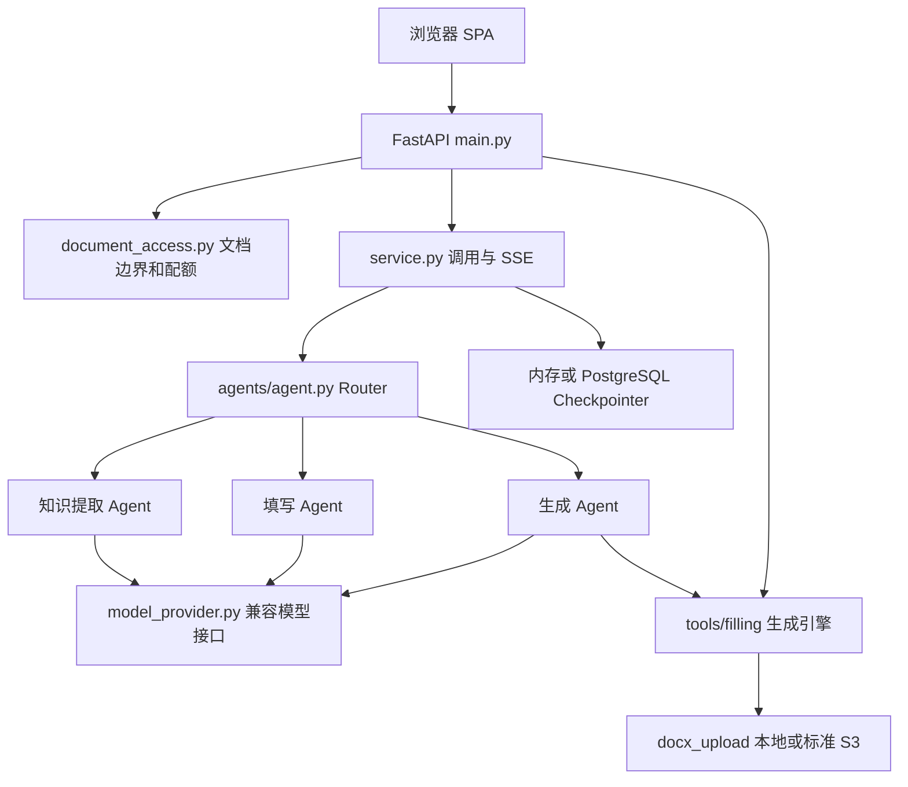

# FormWise 独立部署架构

## 项目定位与运行边界

应用将 Word 模板与知识材料转为字段建议，经用户编辑后生成保留模板格式的 Word 文档。
使用 Python 3.12+、FastAPI、LangGraph、python-docx/OpenXML；前端为原生 HTML/CSS/JavaScript 单页应用。依赖由 uv.lock 锁定。
当前定位为受信任的单用户工具，保持单 worker。应用监听 0.0.0.0:5000；localhost 访问地址不等于只监听回环地址。远程多用户部署需要身份认证和资源归属设计。

## 数据流与模块边界

| 模块 | 职责 |
| --- | --- |
| `runtime.py` | 项目路径、环境加载、请求 ContextVar |
| `document_access.py` | 文档目录/类型边界、上传配额、ZIP 展开限制、远程存储来源校验 |
| `http_limits.py` | ASGI 接收阶段的请求大小上限，包括未提供 Content-Length 的请求 |
| `main.py` | API、上传、预览、生成、下载；同步文档处理通过线程池执行 |
| `service.py` | Graph 调用、稳定会话 ID、单次 run ID、同会话并发保护、工具事件、SSE 心跳与取消 |
| `agents/agent.py` | Router → 知识提取/填写/生成节点；按阶段标记决定下一节点 |
| `model_provider.py` | 对话、事实提取、预填共同使用显式配置的模型接口 |
| `template_analyzer.py` | 冒号字段、标签空白格、段落横线、复选框、多列与行组识别 |
| `tools/filling/` | 数据展开、字段/段落/复选框/重复行填写、样式继承、XML 后处理 |
| `form_filling_state.py` | 字段值、确认状态、行组和序列化 |
| `docx_validator.py` | 结构检查、模板差异与可修复 XML 问题 |
| `docx_upload.py` | 保存、校验/修复、可选上传；本地与 S3 发布相同最终字节 |
| `storage/memory/` | 内存兜底、可选 PostgreSQL 图消息历史 |
| `storage/database/db.py` | 可直接使用的 SQLAlchemy PostgreSQL 会话工厂；不是 SQLite |

## API（以当前路由为准）

| 方法 | 路径 | 用途 |
| --- | --- | --- |
| GET | `/`, `/web/`, `/health` | 前端与健康检查 |
| POST | `/run`, `/stream_run` | 同步图执行与简洁 SSE |
| POST | `/v1/chat/completions` | 前端所需的兼容接口子集 |
| POST | `/cancel/{run_id}`, `/node_run/{node_id}` | 取消和单节点执行 |
| GET | `/graph_parameter` | 图输入输出 schema，可能需要模型配置 |
| POST | `/upload`, `/upload-template` | 上传知识材料或 docx 模板 |
| POST | `/prefill`, `/cofill-generate` | 预填与人工确认后的直接生成 |
| GET | `/template-preview`, `/generated-preview` | 文档 HTML 预览 |
| GET | `/download-docx`, `/convert-pdf` | Word 下载、可选 LibreOffice 转 PDF |

历史文档中的 `/templates`、`/cofill-fast-generate`、`/docx-download-url` 不是当前服务已实现的接口。

## 配置与存储

进程环境变量优先于 `projects/.env`。模型使用 EXTERNAL_LLM_BASE_URL/MODEL/API_KEY；不再使用 Coze。
APP_WORKSPACE 默认为 projects，APP_DATA_DIR 默认为工作区下 data。文档访问限于工作区 assets、data/uploads、data/generated、data/pdf_output，并校验真实路径和扩展名。配置目录、源码及整个系统临时目录不在文档边界内。
旧系统临时文件如需重新使用，应通过上传接口导入；不要扩大可下载目录到源码或配置目录。

上传每文件最大 10MB、每次最多 10 文件、HTTP 请求最大 32MB；OOXML 展开后最大 50MB、2048 个条目；上传目录累计最大 100MB。不会自动删除已有用户文件，达到配额后由使用者备份和清理。生成文件的长期保留/配额尚未统一管理。
本地文件是默认存储，可选 S3。远程代理下载只接受 DOWNLOAD_ALLOWED_ORIGINS 中的确切来源或显式 S3_ENDPOINT_URL 来源，禁用自动重定向并限制响应为 10MB。

消息历史可选 PostgreSQL，字段状态仍保存在进程内；重启会丢失字段状态，数据库不会把它自动变成多 worker 或多租户系统。同一会话已有任务时，新的修改请求会被拒绝；这个机制不代替用户身份认证。

## 验证与限制

运行 `uv run pytest -q`、`uv run ruff check src tests scripts`、`node tests/check_frontend.cjs`。
CI 对 Linux/Windows、Python 3.12/3.13 执行相同检查。新增 CI 的实际结果应以对应 GitHub Actions 运行为准。
自动测试使用本地模拟模型和 S3 客户端；真实模型、云端 S3/PostgreSQL、LibreOffice 转换和所有真实文档的视觉一致性需要独立联调。
完整审查结果见 [CODE_REVIEW_REPORT.md](CODE_REVIEW_REPORT.md)。
